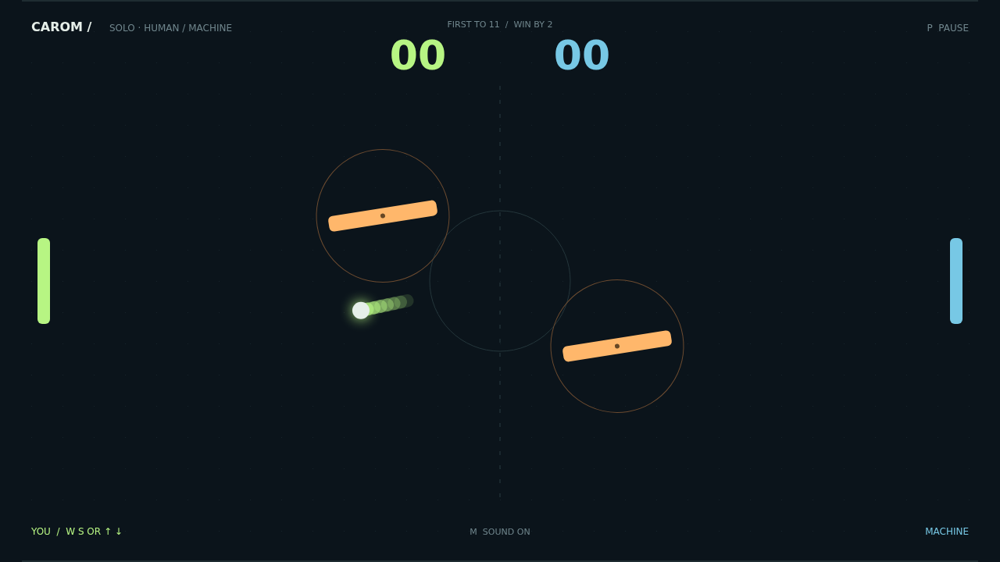

# Carom

Two paddles. One ball. A field that never gives you the same angle twice. Carom puts you across the court from a machine opponent or a friend sharing your keyboard, with two rotating amber gates between you and the goal.

The opening serve gives you a moment to find your rhythm. Catch the ball in the middle for a direct return, or meet it near the end of your paddle to send it climbing toward a wall. Each paddle hit makes the rally faster, and every new angle asks you to commit.

Move as you strike and the shot bends. A late sweep can curl a return around a gate; a well-timed bank can send it somewhere your opponent wasn't watching. The gates sway and rotate together, turning a familiar straight shot into a little puzzle of timing and reflection.

Keep your nerve at match point. First to eleven wins, but only with a two-point lead—at ten-all, there is still everything to play for. Take a breath, find your angle, and make the next return count.

